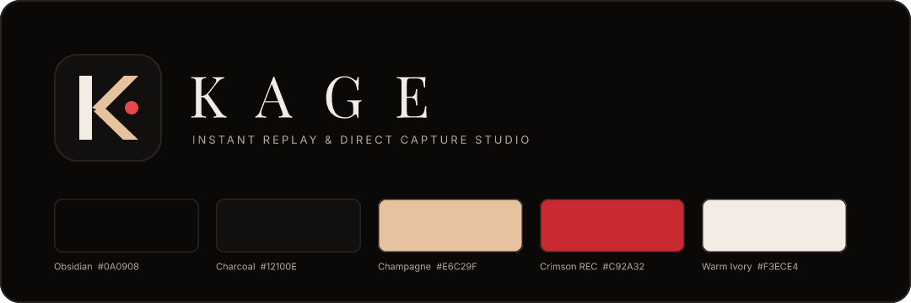
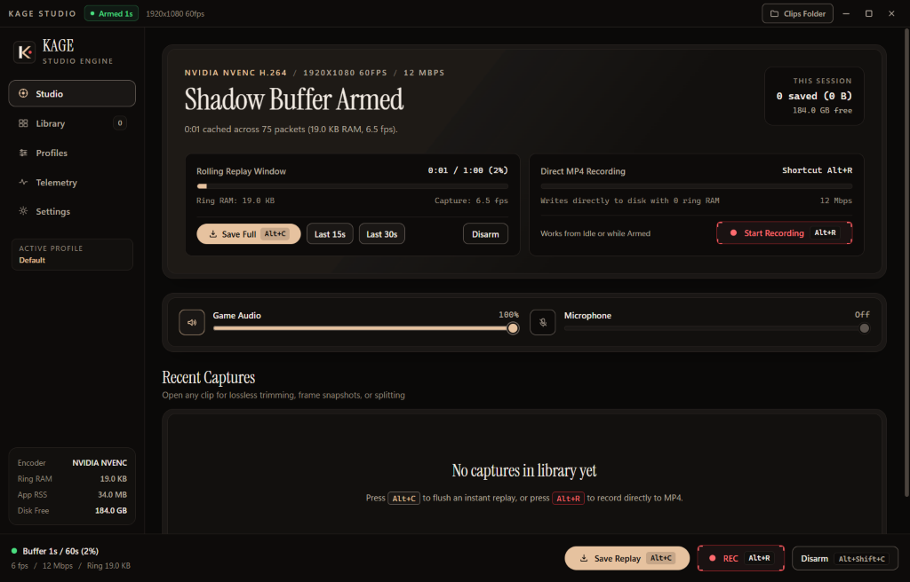
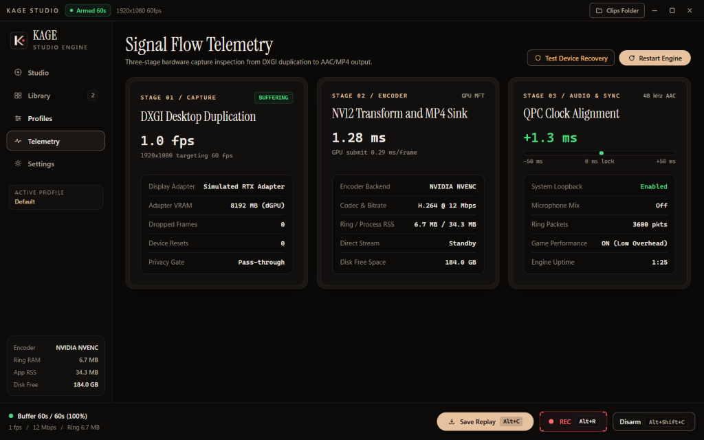
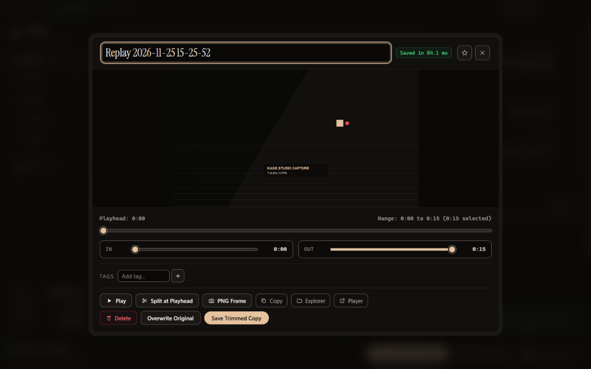
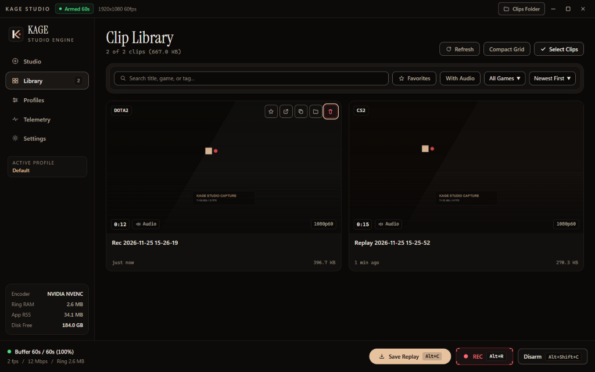
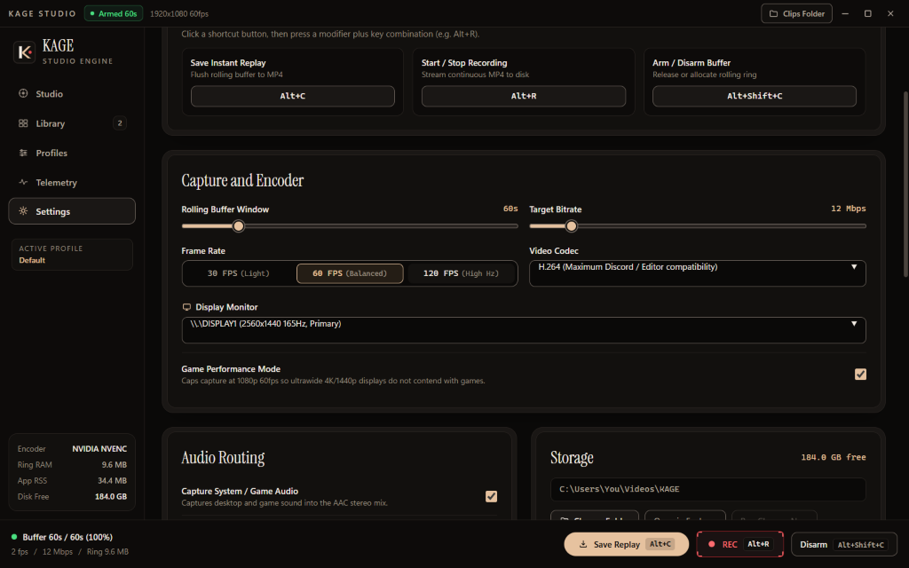

<p align="center">
  
</p>

<h3 align="center">Lightweight Instant Replay &amp; Direct MP4 Capture Studio for Windows</h3>

<p align="center">
  <em>Formerly ClipFlow. Rebuilt from the ground up for low memory overhead, zero background telemetry, GPU hardware encoding, and an editorial obsidian deck.</em>
</p>

---

## Overview

**KAGE** (`KAGE Studio`) is a native Windows 10 and Windows 11 screen capture application built with **Rust**, **Direct3D 11 Desktop Duplication**, **Windows Media Foundation**, **WASAPI**, and **Tauri v2**.

It combines two capture workflows inside a single lightweight GPU pipeline:

1. **Instant Replay (`Alt + C`)**: Keeps the last 15 to 300 seconds of GPU-encoded H.264/HEVC frames inside a bounded circular RAM buffer and flushes them instantaneously to MP4 without interrupting gameplay or stealing window focus.
2. **Direct MP4 Recording (`Alt + R`)**: Streams long-form screen + audio recordings straight to disk with zero replay ring overhead when disarmed, or shares the live hardware encoder when Replay Buffer is already armed.

| Studio Deck (Armed) | Signal Flow Telemetry |
| :---: | :---: |
|  |  |

| Lossless Clip Trimmer | Clip Library &amp; Batch Actions |
| :---: | :---: |
|  |  |

| Settings &amp; Pipeline Controls |
| :---: |
|  |

---

## Key Features

- **GPU-Accelerated Zero-Copy Capture**: Supports **NVIDIA NVENC**, **AMD AMF**, and **Intel Quick Sync** (H.264 &amp; HEVC) over Direct3D 11 textures, falling back cleanly when needed.
- **Direct MP4 Recording (`Alt + R`)**: Start and stop continuous MP4 recordings with a single hotkey or deck toggle via a dedicated bounded `IMFSinkWriter` thread (`kage-rec-writer`).
- **Low RAM &amp; Tray Working-Set Trimming**: Bounded `RollingRingBuffer`, disk-backed JPEG thumbnail cache (`%APPDATA%\KAGE\thumbs\`), reusable AAC COM encoder buffers, and automatic Windows working-set trimming (`SetProcessWorkingSetSizeEx`) when minimized to tray.
- **Dual WASAPI Synchronized Audio**: Mixes game/desktop loopback audio and microphone input (`0%` to `100%` gain) with monotonic timestamp drift tracking and automatic device recovery.
- **Lossless Keyframe Stream-Copy Editor**: Trim In/Out points (Copy or Overwrite), Split at Playhead, and extract full-resolution PNG frame snapshots without re-encoding video.
- **Per-Game Profiles &amp; ECO Power Policy**: Map `.exe` targets to dedicated FPS/bitrate/buffer presets, pause capture automatically via Privacy Gate on desktop focus, or shrink ring size under Adaptive ECO battery/RAM rules.
- **100% Offline &amp; Private**: Zero cloud accounts, zero telemetry sockets, and zero background update polling.

---

## Default Keyboard Shortcuts

| Shortcut | Action | Behavior |
| :--- | :--- | :--- |
| `Alt + C` | **Save Replay** | Flushes the active rolling memory buffer to an MP4 file |
| `Alt + R` | **Start / Stop Recording** | Streams a continuous MP4 directly to disk (0 extra ring RAM if idle) |
| `Alt + Shift + C` | **Arm / Disarm Buffer** | Starts or releases the background rolling memory buffer |

All three hotkeys can be customized with conflict detection and OS rollback in **Settings -&gt; Global Shortcuts**.

---

## Project Architecture

```text
kage/
├── design/                # FigCraft design file, command generator & PNG/SVG exports
├── src/                   # Modular React 19 + TypeScript + Tailwind v4 desktop deck
│   ├── components/        # TitleBar, Sidebar, TransportBar, GalleryGrid, ClipTrimmerModal
│   ├── views/             # StudioView, LibraryView, ProfilesView, TelemetryView, SettingsView
│   └── lib/               # Tauri IPC bridge, virtual grid, selection, privacy & ECO policy
└── src-tauri/             # Native Rust backend
    └── src/
        ├── media/         # DXGI D3D11 + MFT recorder, WASAPI/AAC audio, lossless MP4 library
        ├── hotkeys.rs     # Global Windows shortcut manager (Alt+C / Alt+R / Alt+Shift+C)
        ├── commands.rs    # Tauri IPC surface, CF_HDROP clipboard & disk telemetry
        ├── settings.rs    # Persistent JSON configuration (%APPDATA%\KAGE\settings.json)
        └── foreground.rs  # Toolhelp32 active executable detection for profiles & privacy gate
```

---

## System Requirements

- **OS**: Windows 10 (1809+) or Windows 11 (64-bit)
- **GPU**: DirectX 11.1 GPU with hardware encode support (NVIDIA NVENC, AMD AMF, or Intel Quick Sync)
- **RAM**: 8 GB recommended (4 GB supported with shorter rolling buffer windows; Direct `Alt + R` recording uses 0 ring memory)

---

## Building from Source

### Prerequisites

- [Rust](https://www.rust-lang.org/tools/install) (1.77.2 or newer)
- [Node.js](https://nodejs.org/) (v20+)
- Visual Studio C++ Build Tools with Windows 10/11 SDK

### Development &amp; Verification

```powershell
# Install dependencies
npm install

# Run frontend typecheck, Vitest unit tests, and Vite bundle
npm run typecheck
npm test
npm run build

# Run Rust tests (headless simulator + Windows native) & Clippy
cargo test --manifest-path src-tauri/Cargo.toml --features headless-sim
cargo test --manifest-path src-tauri/Cargo.toml
cargo clippy --manifest-path src-tauri/Cargo.toml --all-targets -- -D warnings

# Build standalone executable and Windows installers (NSIS / MSI)
npm run tauri build
```

---

## Credits &amp; Origin

KAGE evolved from [ClipFlow-Dev](https://github.com/drexjgobgt/ClipFlow-Dev), rebranded and engineered with direct MP4 recording, COM/DXGI resource leak fixes, working-set RAM optimizations, and a ground-up FigCraft UI overhaul. Licensed under the [MIT License](LICENSE).
